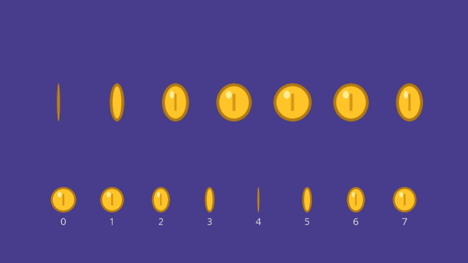
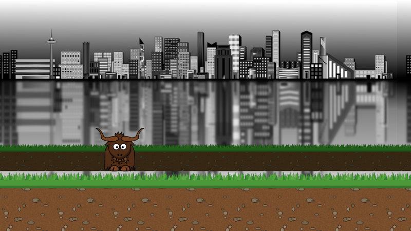
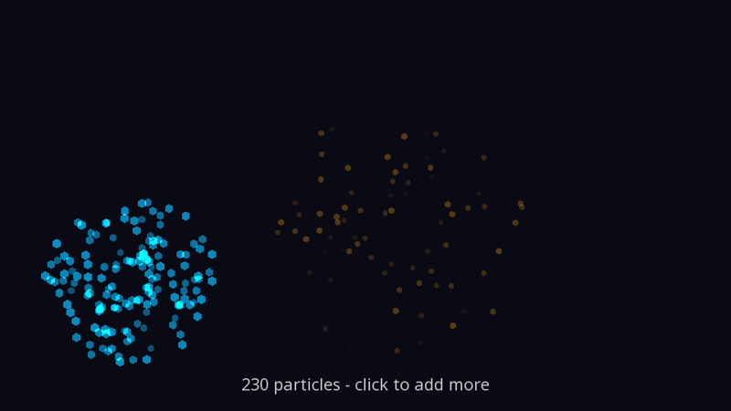
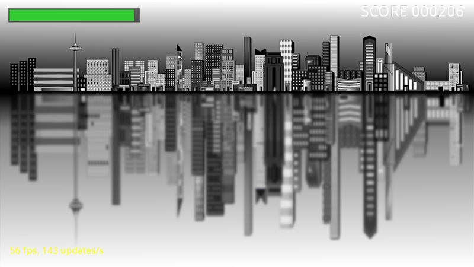
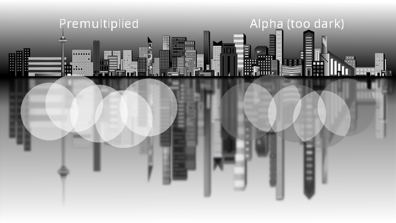

# Cookbook

Short, complete answers to "how do I...?" questions that come up in almost every game. Each recipe is a small, runnable program: the code shown is taken from [Recipes.cs](https://github.com/AlzPatz/yak2d-docs-content/blob/master/code/Snippets/Recipes.cs) and compiled every time these docs are published. Run any of them from the `code/Snippets` folder of the [docs repository](https://github.com/AlzPatz/yak2d-docs-content):

```bash
dotnet run -- SpriteAnimation
```

Like the guide examples, recipes derive from a tiny [`Example` base class](https://github.com/AlzPatz/yak2d-docs-content/blob/master/code/Snippets/Example.cs) that provides a 960 x 540 window, quits on **Escape**, and recreates resources after a [device reset](lifecycle.md#device-resets).

| I want to... | Recipe |
|---|---|
| Animate a sprite from a sprite sheet | [Sprite sheet animation](#sprite-sheet-animation) |
| Shake the screen when something hits | [Screen shake](#screen-shake) |
| Fade to black between scenes | [Fade transitions](#fade-to-black-between-scenes) |
| Scroll layered backgrounds at different speeds | [Parallax scrolling](#parallax-scrolling) |
| Make sparks, explosions and magic | [Particles](#particles) |
| Show health, score and frame rate | [A HUD](#a-hud-health-bar-score-and-fps) |
| Toggle full screen and pause the game | [Full screen and pause](#full-screen-and-pause) |
| Draw a translucent layer over a scene | [A transparent layer](#a-transparent-layer-over-a-scene) |
| ...and more | [Recipes elsewhere in the docs](#recipes-elsewhere-in-these-docs) |

## Sprite sheet animation



A sprite sheet packs every frame of an animation into one texture. Choose the frame from the time, then show just that slice of the texture by setting the texture coordinates of [DrawTexturedQuad](xref:Yak2D.IDrawingHelpers.DrawTexturedQuad*). Texture coordinates run from 0 to 1 across the whole image, so with eight frames side by side, frame `n` spans `n / 8` to `(n + 1) / 8`.

[!code-csharp[](../code/Snippets/Recipes.cs#sprite-animation)]

- **Mirroring for free:** swap the left and right texture coordinates to face a sprite the other way, rather than storing a flipped copy.
- **Sheets in a grid** work the same way: pick a row as well as a column, and set `texcoord_min_y` and `texcoord_max_y` too.
- **Faint lines at frame edges?** Leave a pixel or two of transparent space round each frame, because filtering samples slightly into the neighbouring frame. For crisp pixel art, also load the sheet with [SamplerType.Point](xref:Yak2D.SamplerType) (see [Texture options](assets.md#texture-options)).
- Because every frame comes from the same texture, a crowd of animated sprites still [batches](drawing.md#performance-tips) into very few GPU draw calls.

## Screen shake

A shake is a small, fast, random offset added to the camera, which decays over time. Keeping a single `_trauma` value between 0 and 1, adding to it on each hit and letting it wear off, gives shakes that combine naturally when several things happen at once:

[!code-csharp[](../code/Snippets/Recipes.cs#screen-shake)]

The shake is applied in [PreDrawing()](xref:Yak2D.IApplication.PreDrawing*), the place for camera moves, so it is as smooth as the frame rate allows. In a real game, add the offset to wherever your [following camera](cameras.md#following-a-player) is already looking.

> [!TIP]
> [Screen space](coordinatesystems.md#screen-space) is fixed to the camera's view, so screen-space text shakes too. Draw the HUD through a second, still camera if it should stay steady: see [More than one camera](cameras.md#more-than-one-camera).

## Fade to black between scenes

Draw a black rectangle over the whole view, on a [layer](drawing.md#layers-and-depth) above everything else, and animate its alpha. Fade out, swap the scene while the screen is black, then fade back in:

[!code-csharp[](../code/Snippets/Recipes.cs#fade)]

The fade runs in [Update()](xref:Yak2D.IApplication.Update*), so it takes the same time however fast the computer is, and key presses are ignored while a fade is in progress.

For fades and colour changes applied to a whole rendered image, such as a slow fade to grey when the player dies, use a [colour effects stage](effects.md#colour-effects) with a [smooth transition](renderstages.md#smooth-transitions) instead. [Yak Run part 4](../tutorials/yakrun-4.md) does exactly that.

## Parallax scrolling



Layers further away should move more slowly as the camera moves. A simple way to do this without any extra cameras is to draw each background layer in **screen space**, covering the view, and scroll its *texture coordinates* by a fraction of the camera's position. With [TextureCoordinateMode.Wrap](xref:Yak2D.TextureCoordinateMode) the texture repeats for ever, so the layers never run out:

[!code-csharp[](../code/Snippets/Recipes.cs#parallax)]

Speed `1.0` keeps pace with the world (the ground the yak walks on); `0.1` barely moves (the distant city). Lower [depth](drawing.md#layers-and-depth) values are nearer, so each layer is drawn in front of the slower ones behind it.

For backgrounds that are made of separate objects (mountains, clouds) rather than tiling textures, give the background its own draw stage and camera, and move that camera more slowly. [Yak Run part 3](../tutorials/yakrun-3.md#a-following-camera-and-parallax) shows that approach.

## Particles



Particles are many small, short-lived shapes. Keep them in a list of plain structs, move them in `Update()`, and draw them every frame. Drawing onto a stage created with [BlendState.AdditiveAlpha](drawing.md#blend-states) adds each particle's colour to what is behind it, so overlapping sparks glow brighter, like real light:

[!code-csharp[](../code/Snippets/Recipes.cs#particles)]

- **Thousands are fine.** Every particle here is one small coloured polygon on one stage, so they all go to the GPU together.
- **Use textures** for soft or shaped particles: swap `DrawColouredPoly` for `DrawTexturedQuad` with a small blurred-dot image, all from one texture or [sprite sheet](#sprite-sheet-animation).
- **More glow:** render the particles into a [render target](surfaces.md#render-targets) and run [bloom](effects.md#bloom) over it.
- The struct is copied out of the list, changed and written back, because a `List<T>` of structs cannot be changed in place.

## A HUD: health bar, score and FPS



HUD elements belong in [screen space](coordinatesystems.md#screen-space), which is fixed to the camera's view with (0,0) in the middle. For a 960 x 540 camera the edges are at x = ±480 and y = ±270, so position everything relative to those. Text [justification](text.md#drawing-a-string) helps: right-justified text grows leftwards from the point you give, which keeps a score tucked into the right-hand corner.

[!code-csharp[](../code/Snippets/Recipes.cs#hud)]

Quads are positioned by their *centre*, so a bar that empties to the left needs its centre moved as its width shrinks, as `DrawBar` does. A high [layer](drawing.md#layers-and-depth) (here 10) keeps the HUD above the game whatever depths the game uses. The frame rates come from the [IFps](xref:Yak2D.IFps) passed to `Drawing()`.

## Full screen and pause

Two things players expect from any game: a full-screen toggle, and pausing when they switch to another window.

[!code-csharp[](../code/Snippets/Recipes.cs#window-controls)]

- [DisplayState.BorderlessFullScreen](xref:Yak2D.DisplayState) covers the screen with a borderless window, which switches quickly and plays well with alt-tab. `DisplayState.FullScreen` is exclusive full screen. See [Window, display and graphics API](window.md).
- [FrameworkMessage.WindowLostFocus](lifecycle.md#framework-messages) arrives through [ProcessMessage()](xref:Yak2D.IApplication.ProcessMessage*). The override calls `base.ProcessMessage()` so resources are still recreated after a [device reset](lifecycle.md#device-resets).
- Pausing just means not advancing the game in `Update()`. Drawing carries on, so the paused scene (and a "paused" message) stays on screen.

## A transparent layer over a scene



Sometimes a group of translucent things should be drawn into a render target of its own first: so it can be blurred, faded or distorted as one, or reused. A render target cleared to [Colour.Clear](xref:Yak2D.Colour) and drawn into with `Alpha` blending holds *premultiplied* colour, and must be drawn over the scene with a stage using `BlendState.Premultiplied` (yak2D 1.2.0 and later):

[!code-csharp[](../code/Snippets/Recipes.cs#transparent-layer)]

The left half uses `Premultiplied` and the clouds are clean white. The right half draws exactly the same layer with `Alpha`, which scales the colour by alpha a second time, so the soft areas turn grey. See [Transparent render targets](drawing.md#transparent-render-targets-and-premultiplied).

Note the order in `Rendering()`: the layer is rendered *before* the stage that draws it, because the render queue runs in the order it is built. A [render target](xref:Yak2D.IRenderTarget) is also a [texture](xref:Yak2D.ITexture), so it can be drawn with any texture-drawing function.

## Recipes elsewhere in these docs

| I want to... | Where |
|---|---|
| Make the camera follow the player smoothly | [Cameras: Following a player](cameras.md#following-a-player) |
| Find what the mouse is pointing at in the world | [Coordinate systems: Converting between spaces](coordinatesystems.md#converting-between-spaces) |
| Give my game a chunky, low-resolution pixel-art look | [Surfaces: A retro, low-resolution look](surfaces.md#example-a-retro-low-resolution-look) |
| Split the screen between two players | [Viewports](viewports.md) |
| Draw text that fits in a box | [Text: Measuring text](text.md#measuring-text) |
| Draw thousands of unchanging shapes cheaply | [Drawing: Drawing things once](drawing.md#drawing-things-once) |
| Make something glow | [Effects: Bloom](effects.md#bloom) |
| Add ripples and shock waves | [Distortion](distortion.md) |
| Blend smoothly between two effect settings | [Smooth transitions](renderstages.md#smooth-transitions) |
| Read a pixel's colour back from the GPU | [Reading pixels back](readback.md) |
| Make a texture from my own pixel data | [Surfaces: Textures from data](surfaces.md#textures-from-data) |
| Wrap the game onto a curved CRT screen | [3D meshes](mesh.md) |
| Write my own effect | [Writing a custom shader](../tutorials/customshader.md) |
| Ship the game to players | [Distributing your game](../tutorials/distribution.md) |
