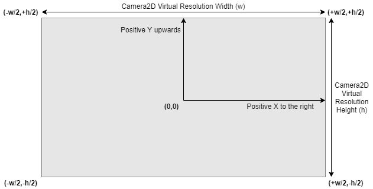
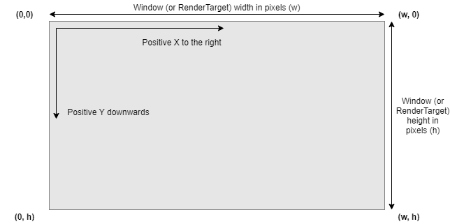
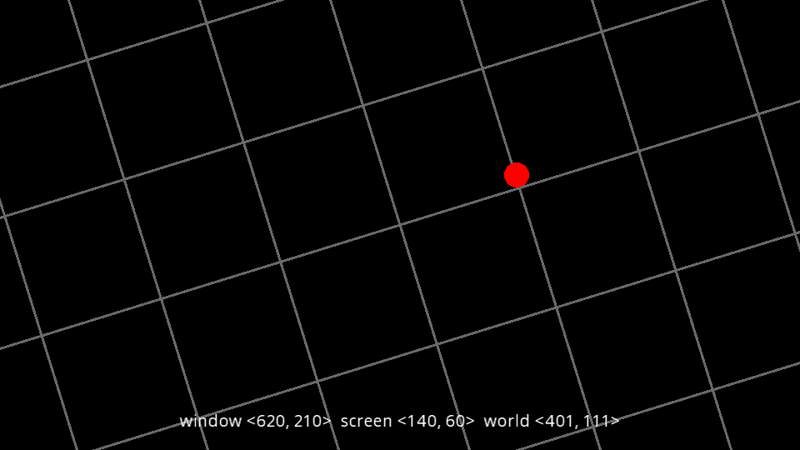

# Coordinate systems

Every position you give yak2D is in one of three coordinate systems, or *spaces*. Two of them are for drawing, and one is the window's own pixel grid. This page explains each, how a camera connects them, and how to convert between them (for example, to find what the mouse is pointing at).

## The three spaces at a glance

| Space | Origin (0,0) | +X | +Y | Units | Use it for |
|---|---|---|---|---|---|
| [**World**](#world-space) | a fixed point in your game world | right | **up** | world units | the game world: it moves, zooms and rotates with the camera |
| [**Screen**](#screen-space) | the centre of the camera's view | right | **up** | the camera's virtual resolution | HUDs, menus, overlays: fixed to the view |
| [**Window**](#window-space) | the top-left corner of the window | right | **down** | real pixels | the mouse position, and viewports |

Draw requests choose World or Screen with their [CoordinateSpace](xref:Yak2D.CoordinateSpace). Window space is never used for drawing.

## Virtual resolution: why the window size doesn't matter

Draw stages are rendered through a [2D camera](cameras.md), and each camera has a **virtual resolution**, for example 960 x 540. That is how many units the camera shows across and down, whatever the real size of the window or render target it renders onto.

A render stage's output always fills its whole *render area*: the entire render target, or the part of it set by a [viewport](viewports.md). So a 960 x 540 camera rendering onto a 1920 x 1080 window draws everything at twice the size, and onto a 640 x 360 render target at two thirds. You design your game once, in the camera's units, and it fits any display.

> [!IMPORTANT]
> If the render area's shape (aspect ratio) differs from the camera's virtual resolution, the picture is stretched or squashed to fit. Keep them in the same proportion. See [Cameras: Virtual resolution](cameras.md#virtual-resolution).

## Screen space

Draw with [CoordinateSpace.Screen](xref:Yak2D.CoordinateSpace) for things fixed to the view. The origin is the centre of the camera's view, +x is right and +y is **up**. The camera's position, zoom and rotation have no effect.

For a camera with virtual resolution `w` x `h`, the visible area is:

- `-w/2 <= x < w/2`
- `-h/2 <= y < h/2`

So for a 960 x 540 camera, the left and right edges are at x = -480 and 480, and the top and bottom at y = 270 and -270. A score in the top-right corner might go at `(460, 250)`. The [HUD recipe](cookbook.md#a-hud-health-bar-score-and-fps) shows this in practice.

## World space

Draw with [CoordinateSpace.World](xref:Yak2D.CoordinateSpace) for everything that is part of the game world. The axes are the same as screen space (+x right, +y up), but what is visible depends on the camera:

- **Focus**: the world position at the centre of the view.
- **Zoom**: the view shows `w / zoom` by `h / zoom` world units. A zoom of 2 shows half as much, twice as big.
- **Rotation**: the view is turned clockwise by the camera's angle, in radians.

With the focus at (0,0), a zoom of 1 and no rotation, world space and screen space line up exactly. Move the camera with [SetCamera2DFocusZoomAndRotation()](xref:Yak2D.ICameras.SetCamera2DFocusZoomAndRotation*) and its relatives; see [Cameras](cameras.md#moving-zooming-and-rotating).

> [!TIP]
> Both world and screen space put +y **up**, like a maths graph, so jumping means *adding* to y and gravity *subtracts* from it. Window space is the odd one out.

## Window space

Window space is the real pixel grid of the window (or of a render target). The origin is the **top-left** corner, +x is right and +y is **down**. Units are whole pixels, and the visible pixels are:

- `0 <= x < width`
- `0 <= y < height`

Two things use window space:

- **The mouse.** [IInput.MousePosition](xref:Yak2D.IInput.MousePosition) is in window pixels. [Convert it](#converting-between-spaces) to world or screen space before comparing it with anything you drew.
- **Viewports.** [CreateViewport(x, y, width, height)](xref:Yak2D.IStages.CreateViewport*) takes the top-left corner and size of a rectangle of the target, in pixels. See [Viewports](viewports.md).

## Converting between spaces

[ICoordinateTransforms](xref:Yak2D.ICoordinateTransforms) converts positions between the three spaces for a given camera. It is available as the `transforms` parameter of `Drawing()`, and as `yak.Helpers.CoordinateTransforms` everywhere else.

| Method | Converts |
|---|---|
| [WorldFromScreen](xref:Yak2D.ICoordinateTransforms.WorldFromScreen*), [ScreenFromWorld](xref:Yak2D.ICoordinateTransforms.ScreenFromWorld*) | between world and screen space |
| [WorldFromWindow](xref:Yak2D.ICoordinateTransforms.WorldFromWindow*), [ScreenFromWindow](xref:Yak2D.ICoordinateTransforms.ScreenFromWindow*) | from a window position (such as the mouse) into world or screen space |
| [WindowFromWorld](xref:Yak2D.ICoordinateTransforms.WindowFromWorld*), [WindowFromScreen](xref:Yak2D.ICoordinateTransforms.WindowFromScreen*) | from world or screen space to a window position |

Methods involving window space take an optional [viewport](viewports.md), for when the camera is rendered into part of the window, and return a [TransformResult](xref:Yak2D.TransformResult): the converted `Position`, plus `Contained`, which says whether the point is actually inside the camera's view (or, converting to window space, inside the window).

A common use is finding what the mouse is pointing at in the game world. Here the camera is zoomed and rotated, and clicks still land exactly under the pointer:

[!code-csharp]

The conversions take the camera's focus, zoom, rotation and virtual resolution into account, and the window's current size, so they keep working when the window is resized.

## Texture coordinates

Texture coordinates pick a point on a texture, from **(0,0) at the top-left** to **(1,1) at the bottom-right**, whatever the texture's size in pixels. Values outside 0 to 1 repeat or mirror the texture, depending on the [TextureCoordinateMode](xref:Yak2D.TextureCoordinateMode). See [Drawing: Texture coordinates](drawing.md#texture-coordinates-wrapping-and-filtering).

The top-left origin is the same on every graphics API. Shaders for [custom shader stages](customshaders.md) can assume it too: the vertex shader yak2D supplies already accounts for OpenGL's differences. In [custom Veldrid stages](customveldrid.md) you write all the GPU code yourself, so the differences between APIs are yours to handle.

## 3D rendering

The [mesh render stage](mesh.md) uses a [3D camera](xref:Yak2D.ICamera3D) for its view and projection. yak2D's 3D space is **right-handed**, the same on every graphics API: +x to the right, +y up, and +z out of the screen, towards the viewer. As with texture coordinates, [custom Veldrid stages](customveldrid.md) must handle any differences between graphics APIs themselves.

## See also

- [Cameras](cameras.md): creating, moving, zooming and rotating cameras
- [Viewports](viewports.md): rendering into part of a target
- [Cookbook](cookbook.md): HUDs, parallax and screen shake, all built on these spaces
