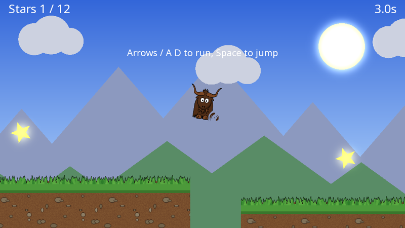
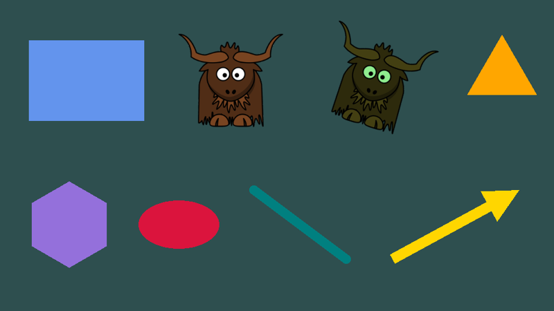
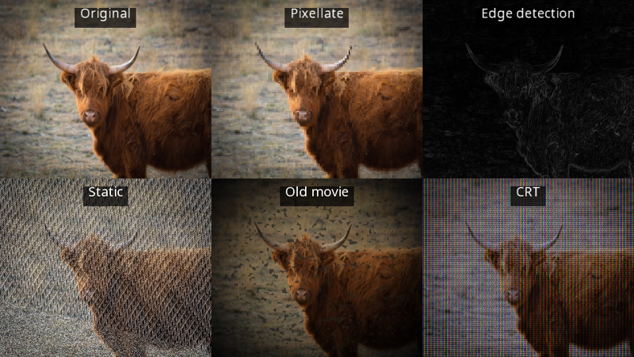
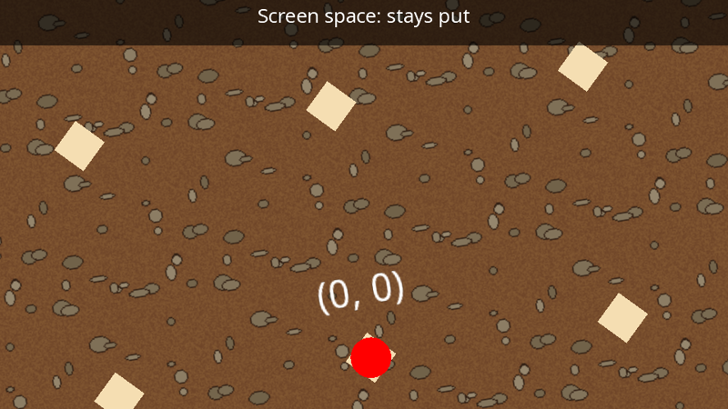
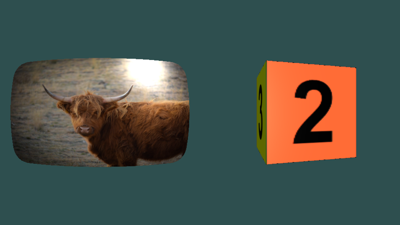

# yak2D

**Write a 2D game in plain C#. Run it on Windows, Linux and macOS.**

yak2D is a small, code-first framework that gives you a window, a game loop, input, and a GPU rendering pipeline you can bend into almost any shape, all from one NuGet package with nothing else to install. There is no editor and no engine to fight: you write a class, and yak2D runs it.

[](https://www.nuget.org/packages/Yak2D/) [](https://github.com/AlzPatz/yak2d/blob/master/license.txt)



*[Yak Run](tutorials/yakrun-1.md): the platform game you build, from an empty folder, in the four-part tutorial.*

## From nothing to a window in three commands

With the [.NET 10 SDK](https://dotnet.microsoft.com/download) installed, on any of the three platforms:

```bash
dotnet new console -n Hello && cd Hello
dotnet add package Yak2D
dotnet run      # after pasting in the code below
```

This is a complete program. Put it in `Program.cs`:

```csharp
using System.Numerics;
using Yak2D;

Launcher.Run(new Hello());
```

[!code-csharp[](code/Snippets/Hello.cs#hello)]

Nine methods, each called by yak2D at the right moment: set up in `CreateResources()`, react to input in `Update()`, say *what* to draw in `Drawing()`, and *how* to render it in `Rendering()`. That last split is yak2D's big idea. [How yak2D works](articles/overview.md) explains it in five minutes.

## Where to start

| If you are... | Go to |
|---|---|
| **New to yak2D?** | **[Getting Started](tutorials/gettingstarted.md)**: install, create a project, open a window. About 10 minutes. |
| **Learn by building** | **[Yak Run](tutorials/yakrun-1.md)**: a complete platform game in four parts: sprites, physics, a scrolling level, then bloom, blur and colour effects. |
| **Need it now?** | **[Cookbook](articles/cookbook.md)**: sprite animation, screen shake, fades, parallax, particles, HUDs. Copy, paste, run. |
| **Want the big picture?** | **[How yak2D works](articles/overview.md)**: the handful of ideas everything else is built on. |
| **Looking something up?** | **[Cheat sheet](articles/cheatsheet.md)** for everyday calls on one page, the **[Manual](articles/intro.md)** for depth, and the **[API Reference](api/index.md)** for every type. |

## What it can do

| | |
|---|---|
|  | **2D drawing.** Sprites, shapes, lines, arrows, polygons and text, sorted by layer and depth and batched for the GPU automatically. Or build your own triangles. [Drawing guide](articles/drawing.md) |
|  | **Effects, chained however you like.** Bloom, blur, colour grading, pixellate, CRT, old movie, static, edge detection, distortion and mixing. Render into a surface, run it through any stages, in any order, and blend smoothly between settings. [Effects guide](articles/effects.md) |
|  | **Cameras and resolution independence.** Design at one virtual resolution and run at any window size. Zoom, rotate, follow, split the screen, and convert mouse positions into world space. [Cameras guide](articles/cameras.md) |
|  | **Beyond the built-ins.** Your own GLSL shaders, compiled at runtime for every graphics API. 3D meshes with lighting. GPU-to-CPU readback. Raw NeoVeldrid access when you want to go all the way down. [Custom shaders](articles/customshaders.md) |

And the rest of what a game needs from its framework: [keyboard, mouse and gamepads](articles/input.md), [fixed or variable time steps](articles/lifecycle.md#update-timing), [full screen and window control](articles/window.md), [bitmap fonts](articles/text.md), and Direct3D 11, Vulkan or OpenGL, [switchable while running](articles/window.md#switching-graphics-api). [See every feature](articles/features.md).

## Why yak2D?

- **One package, three platforms.** `dotnet add package Yak2D` brings SDL2 and every native library with it. The same code runs on Windows, Linux and macOS, x64 and arm64.
- **It stays out of your way.** No editor, no scene format, no entity system you have to adopt. Use any .NET library you like for audio, physics or networking.
- **A pipeline, not a black box.** Drawing and rendering are separate, so the scene you draw can be rendered twice, blurred, bloomed, mixed, distorted or wrapped round a mesh before it ever reaches the window.
- **Documentation you can trust.** Every example on this site is a real project, compiled against the latest release every time the docs are published. Screenshots are captured from the code shown.

## Open source

yak2D is MIT licensed: [github.com/AlzPatz/yak2d](https://github.com/AlzPatz/yak2d). It is built on [NeoVeldrid](https://www.nuget.org/packages/NeoVeldrid), [Silk.NET](https://github.com/dotnet/Silk.NET) and [SDL](https://www.libsdl.org/). Questions, bugs and ideas are welcome as [GitHub issues](https://github.com/AlzPatz/yak2d/issues). See [What's new](articles/whatsnew.md) for the latest changes.
